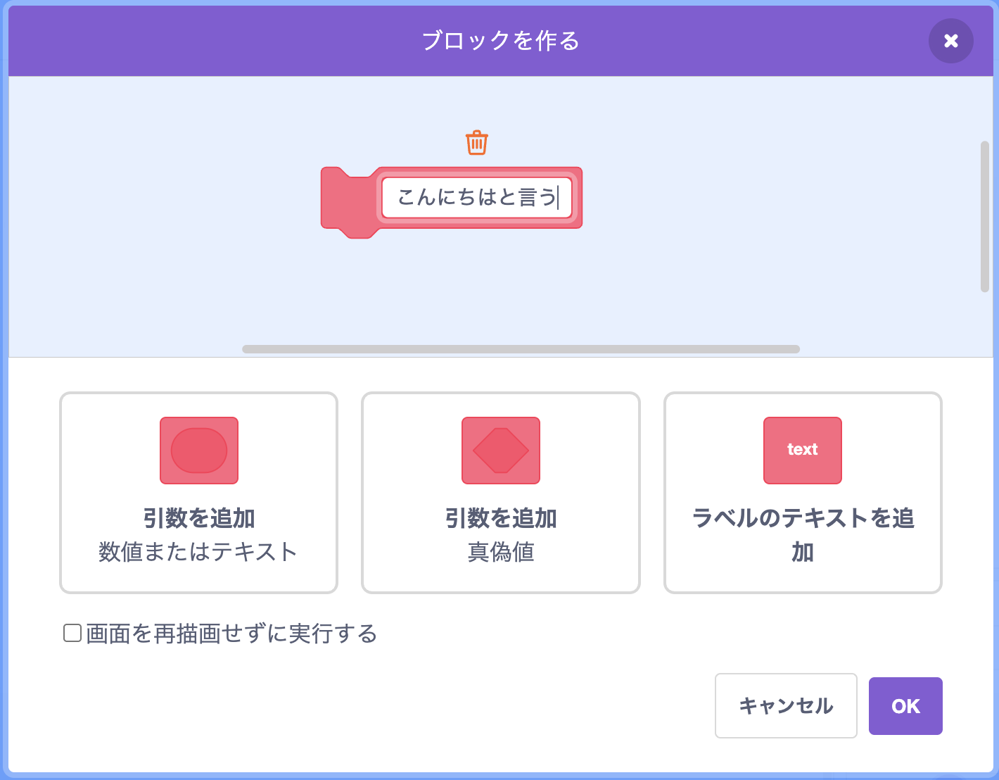
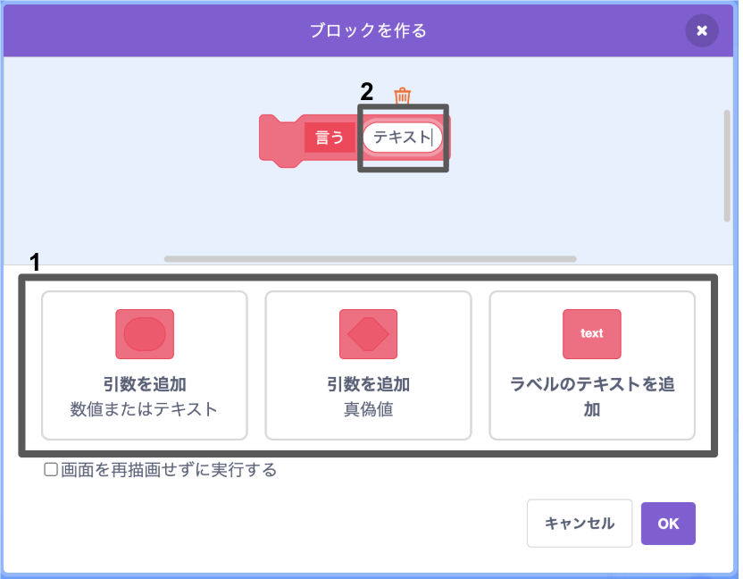
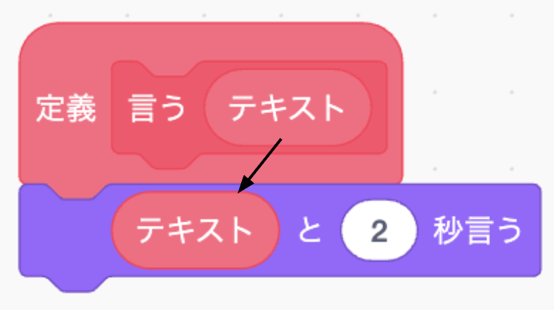

### ブロックを作る

+ **ブロック定義**を押して、**ブロックを作る**をクリックする。

+ あなたの新しいブロックに名前をつけて**OK**を押す。

+ 新しい`定義`ブロックを見ることができる。 そのブロックにコードをつける。

+ そしたら他のブロックのように新しいブロックを使える。

+ 新しい`定義`ブロックにつけられたコードが、ブロックが使われた時に行われる。

### 因数が追加されたブロックを作る

+ データが追加できる「空欄」が存在するブロックを作ることもできます。 この「空欄」を「パラメーター」と言う。 パラメーターを追加するためには、まず新しいブロックを作って、下にある選択肢から追加したいデータを加える。 そして、そのデータに名前をつけて**OK**と押す。

+ あなたが名前をつけたデータの空欄が付け加えられている以外、いつものように新しい`定義`ブロックが出てくる。

+ これで空欄にデータを入れて、新しいブロックを使える。

+ いつも通り新しい`定義`ブロックにつけられたコードが、ブロックが使われた時に実行される。

